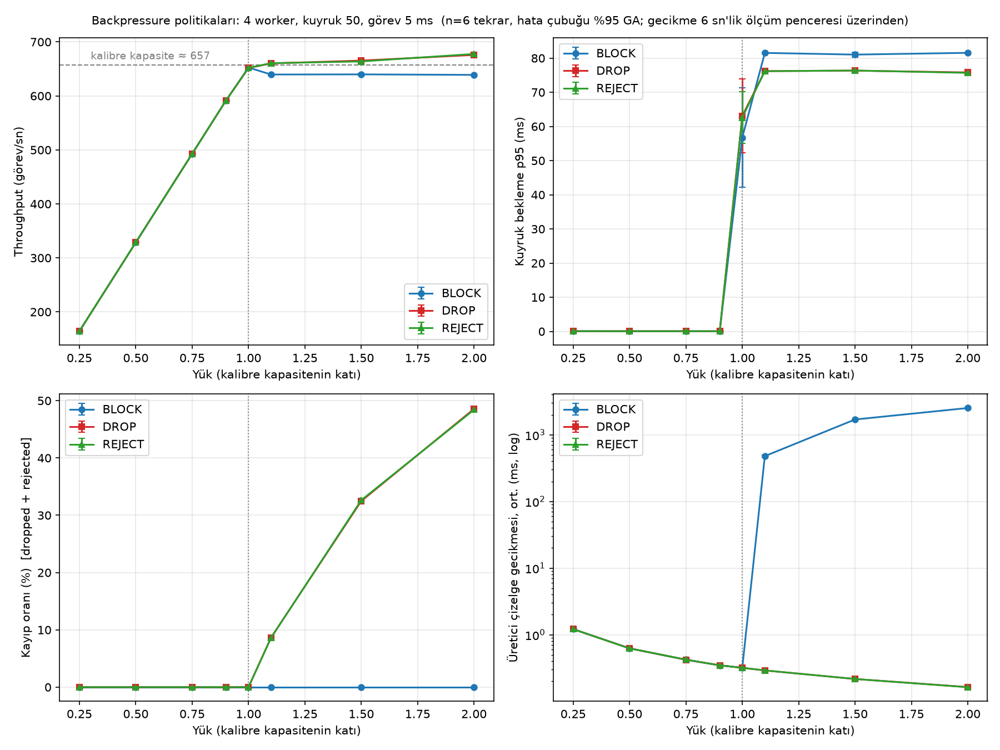

# Lab 1 — Bounded worker pool and backpressure policies

A thread-based worker pool over a bounded queue, and a benchmark comparing what
happens when producers outpace consumers under three backpressure policies.

## Design

`WorkerPool(num_workers, queue_size, policy)` runs tasks on a fixed set of threads
that consume from a bounded FIFO queue. When the queue is full, `submit()` follows
the configured policy:

| Policy | Behaviour when full | Who pays for overload |
|---|---|---|
| `BLOCK` | Producer waits until space frees up (optional timeout → `QueueFull`) | The producer (it slows down) |
| `DROP` | Task is discarded, `submit()` returns `False` (load shedding) | The task (silently lost) |
| `REJECT` | `QueueFull` is raised | The task, but the producer knows |

Key decisions:

- **Single lock** guards all counters and the wait-time samples, so `stats()` returns a consistent snapshot.
- **Deadlock-free shutdown:** `shutdown()` first stops accepting tasks, then waits for producers still inside `submit()`, and only then enqueues one sentinel per worker. Sentinels sit behind queued tasks (FIFO), so the queue drains first. Without this ordering, a producer blocked in `put()` could enqueue a task *after* the sentinels; it would never run, yet `submit()` would have returned `True`.
- **A failing task does not kill its worker;** the exception is counted.
- **Queue wait is stamped at actual insertion** (inside the queue's `_put`), not before `put()`. An earlier version stamped before `put()`, so under `BLOCK` the time a producer spent blocked was counted twice (once as submit latency, once as queue wait). A regression test covers this.

Run the tests (8 tests, including two deadlock scenarios):

```bash
cd concurrency
python -m pytest -q
```

## Experiment

- Pool: 4 workers, queue size 50, each task `sleep(5 ms)` (I/O-like, releases the GIL).
- **Open-loop producer** with an absolute schedule: it does not slow down when the pool does, so overload actually reaches the pool.
- Load is swept from 0.25× to 2× of the **measured** capacity, recalibrated at the start and end of every repeat (calibration uses `DROP`, so the producer never blocks).
- Each trial: 8 s, first 2 s discarded as warm-up. Trial order shuffled within each repeat.
- 6 repeats, each in a fresh process (see *Measurement validity*). All repeats drifted ≤ 0.2 %.
- Besides queue wait and submit latency, the producer records **schedule lag** = actual submit time − intended submit time. Submit latency alone hides the backlog that builds up when a blocked producer falls behind its schedule (*coordinated omission*).

```bash
for r in 1 2 3 4 5 6; do
  python benchmarks/run_benchmark.py --repeats 1 --first-repeat $r --out results/rep_$r.csv
done
python benchmarks/plot_results.py   # after merging rep_*.csv into results/benchmark.csv
```

## Results



Measured capacity: **~657 tasks/s** (theoretical 4 / 5 ms = 800; `sleep(5 ms)` actually takes ~6.1 ms on this machine).

1. **Below capacity (≤ 0.9×) the policies are indistinguishable:** no loss, p95 queue wait < 0.1 ms.
2. **At exactly 1.0× the queue is unstable:** p95 wait swings between ~36 and ~75 ms across repeats with no loss. At utilisation ≈ 1, queue length random-walks.
3. **Above capacity, `DROP` and `REJECT` are mirror images:** throughput stays at capacity and the lost fraction follows `1 − capacity / offered` (≈ 8.6 % at 1.1×, 32.5 % at 1.5×, 48.5 % at 2×).
4. **Queue wait saturates and follows Little's law:** wait ≈ queue size / throughput ≈ 50 / 660 ≈ 76 ms (measured ~76 ms).
5. **`BLOCK` loses nothing, but the cost moves to the producer.** Schedule lag grows without bound for as long as overload lasts: mean ≈ 0.5 s / 1.7 s / 2.6 s at 1.1× / 1.5× / 2× over a 6 s window. This is not visible in submit latency (~1.5 ms).
6. **`BLOCK` saturates ~3–5 % lower** (~639 vs ~660–677 tasks/s), consistently across all repeats. Hypothesis (not verified): the cost of waking the blocked producer for every freed slot. Observation (not verified): `DROP`/`REJECT` throughput creeps slightly above calibrated capacity as offered load rises.

**Trade-off in one line:** under overload you choose between unbounded delay (`BLOCK`) and bounded delay with data loss (`DROP`/`REJECT`). Capacity is the real fix.

## Measurement validity

The first full runs were unusable: capacity dropped mid-run from ~659 to ~550–590 tasks/s and sometimes recovered. A standalone probe (`benchmarks/sleep_probe.py`) showed why:

- `sleep(5 ms)` overshoot steps from ~1.27 ms to ~2.52 ms **after ~5 minutes of process runtime**, and stays there.
- A fixed CPU workload took the same time throughout, and no thermal or power warnings were recorded, so the CPU was not slowing down. The OS timer behaviour changed.

The exact macOS mechanism is unknown. The fix: every repeat runs in its own process and finishes in ~4.4 minutes, before the step. Per-repeat calibration at start and end is what exposed the problem; without it the drifted data would have looked plausible.

## Limitations

- Results are for one machine (Apple M2, macOS) and a sleep-based task; CPU-bound tasks under the GIL would behave differently (threads would not run in parallel).
- All wait-time samples are kept in memory; a long-running system would need a histogram or reservoir.
- `qsize()` is approximate; it is used for observation only.
- `BaseException` (e.g. `KeyboardInterrupt`) is intentionally not caught in workers.
- The benchmark reads two private fields of the pool to slice post-warm-up samples.

## Thesis connection

<!-- Kendi cümlelerinle yaz (3-5 cümle). Yönlendirici sorular:
1. Kuyruk uzunluğu, telemetri hattındaki consumer lag'in neyidir? Little yasası burada ne söylüyor?
2. Bir autoscaler geç tepki verirse sistem hangi politikanın davranışını gösterir: gecikme mi büyür, veri mi kaybolur?
3. 1.0x noktasındaki kararsızlık, "replika sayısını tam kapasiteye ayarlamak" hakkında ne söylüyor?
4. Bu labdaki ölçüm kayması, Kubernetes deneylerinin tasarımı için hangi dersi veriyor?
-->
