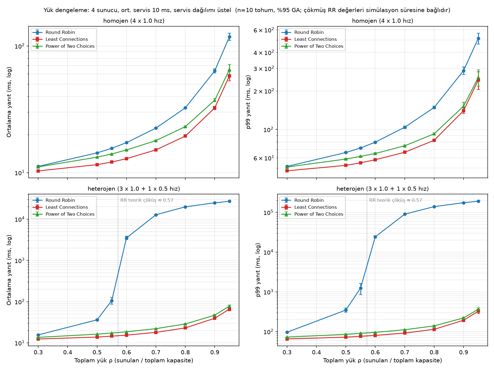
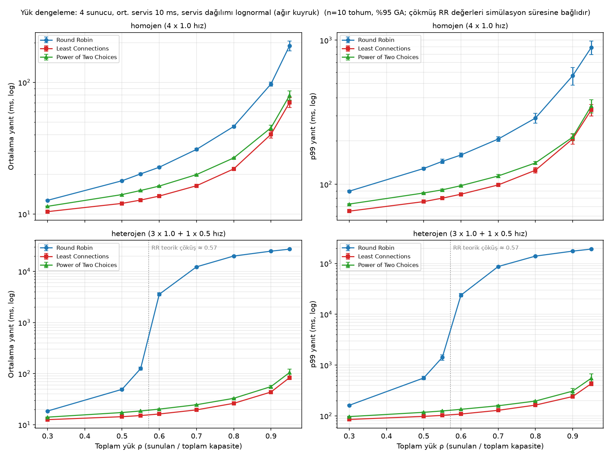

# Lab 2 — Load balancing policies: Round Robin, Least Connections, Power of Two Choices

A discrete-event simulator of one load balancer in front of N servers (each with its own
FIFO queue), used to compare how three routing policies behave as load rises, when one
server is degraded, and when job sizes are heavy-tailed.

## Why a simulator and not real timing

Lab 1 showed that wall-clock benchmarks on a laptop drift: macOS `sleep()` overshoot
stepped up after ~5 minutes of process runtime and corrupted whole runs. A discrete-event
simulation advances its own clock, so results are deterministic (same seed, same result),
immune to OS timer behaviour, and fast (100 000 requests in ~0.1–0.2 s). The cost: no
network latency or real system noise (see *Limitations*).

## Model

- **Arrivals:** Poisson process with rate λ.
- **Servers:** 4 servers, each with its own FIFO queue. Mean service time 10 ms at speed 1.0.
- **Service time distribution:** exponential, or lognormal (σ = 1, same mean, heavier tail).
- **Policies:**
  - `rr` — Round Robin: servers in turn, ignoring their state.
  - `lc` — Least Connections: the server with the fewest jobs in system (queued + in service); ties broken at random.
  - `p2c` — Power of Two Choices: pick two servers at random, send to the one with fewer jobs.
- **Scenarios:** homogeneous (4 × 1.0) and heterogeneous (3 × 1.0 + 1 × 0.5, one degraded server).
- **Load:** ρ = λ / total capacity, swept from 0.3 to 0.95. 100 000 requests per run, first 10 % discarded as warm-up, 10 seeds per point.

## Validation

With a single server, Poisson arrivals and exponential service the model is an M/M/1 queue,
whose mean response time is exactly `1 / (μ − λ)`. For μ = 100/s and λ = 70/s theory gives
33.3 ms; the simulator gives **33.2 ms** (200 000 requests). A test (`tests/test_sim.py`)
checks this within 5 %, together with RR splitting load evenly, LC avoiding a slow server,
and determinism.

```bash
cd load-balancer
python -m pytest -q
python benchmarks/run_sweep.py      # ~960 runs, a few minutes
python benchmarks/plot_results.py
```

## Results




Mean / p99 response time (ms), mean of 10 seeds:

| Scenario | Service | ρ | RR | LC | P2C |
|---|---|---|---|---|---|
| homogeneous | exp | 0.5 | 14.3 / 66 | 11.6 / 52 | 13.3 / 59 |
| homogeneous | exp | 0.8 | 32.5 / 149 | 19.4 / 82 | 23.1 / 92 |
| homogeneous | exp | 0.95 | 118.5 / 515 | 58.1 / 243 | 65.3 / 255 |
| homogeneous | lognormal | 0.95 | 190.0 / 890 | 70.3 / 328 | 79.6 / 350 |
| heterogeneous | exp | 0.5 | 36.2 / 349 | 13.8 / 72 | 16.3 / 85 |
| heterogeneous | exp | 0.55 | 106.3 / 1 251 | 14.6 / 76 | 17.3 / 90 |
| heterogeneous | exp | 0.6 | 3 511 / 24 325 | 15.4 / 80 | 18.6 / 96 |
| heterogeneous | exp | 0.95 | 27 252 / 191 665 | 66.2 / 326 | 78.1 / 366 |

1. **One degraded server collapses Round Robin while most capacity sits idle.**
   RR sends 1/4 of the traffic to the half-speed server, whose utilisation is therefore
   1.75 ρ. Theory predicts collapse at ρ = 1/1.75 ≈ 0.57; the simulation agrees: mean
   response goes from 106 ms at ρ = 0.55 to 3.5 s at ρ = 0.60, while the three healthy
   servers are only ~70 % busy. LC and P2C stay below 100 ms up to ρ = 0.95, because they
   route by observed queue length and the slow server simply receives less work
   (~17 % instead of 25 %; the speed-proportional ideal is 0.5 / 3.5 ≈ 14 %).
2. **Even with identical servers RR is worst at every load.** It ignores queue state, so
   random bursts of long jobs pile up on one server. At ρ = 0.95 its mean response is
   2.0× that of LC (exponential service).
3. **Heavy-tailed jobs widen the gap.** With lognormal service the RR/LC ratio at ρ = 0.95
   rises to 2.7× for the mean and 2.7× for p99 (890 ms vs 328 ms). When one long job blocks
   a server, knowing which server is free matters more.
4. **P2C gets most of LC's benefit from two samples.** At ρ = 0.95 (homogeneous) it closes
   88 % (exponential) and 92 % (lognormal) of the RR–LC gap in mean response, while
   inspecting only two servers per request instead of all of them. With 4 servers the
   saving is small; with hundreds it is the difference between practical and impractical.
5. **Collapsed RR values grow with run length.** Above ρ ≈ 0.57 the slow server's queue
   grows without bound, so those numbers measure how long the simulation ran, not a steady
   state. They show *that* the system is unstable, not *how* slow it is.

## Limitations

- No network delay, connection setup or load-balancer overhead; LC and P2C see queue lengths instantly and exactly. In real systems that information is delayed or approximate, which narrows LC's advantage.
- A single load balancer; with several balancers each seeing only part of the traffic, LC can herd requests onto the same "least loaded" server.
- Servers are FIFO with no timeouts or retries; Lab 3 covers those.
- Utilisation is computed over the whole run including warm-up and drain (approximate).
- Lognormal σ = 1 is one choice of tail weight; heavier tails would widen the gaps further.

## Thesis connection

<!-- Kendi cümlelerinle yaz (3-5 cümle). Yönlendirici sorular:
1. Heterojen senaryoda RR'nin çöküşü, Kubernetes'te yavaşlamış tek bir pod için ne anlama geliyor? Autoscaler o anda replika eklese sorun çözülür müydü?
2. Toplam kapasite yeterliyken sistemin çökmesi, autoscaler'ın yalnızca "ortalama CPU"ya bakmasının riski hakkında ne söylüyor?
3. P2C'nin az bilgiyle iyi sonuç vermesi, karar motorunun hangi metrikleri ne sıklıkla toplaması gerektiği konusunda nasıl bir ders veriyor?
-->