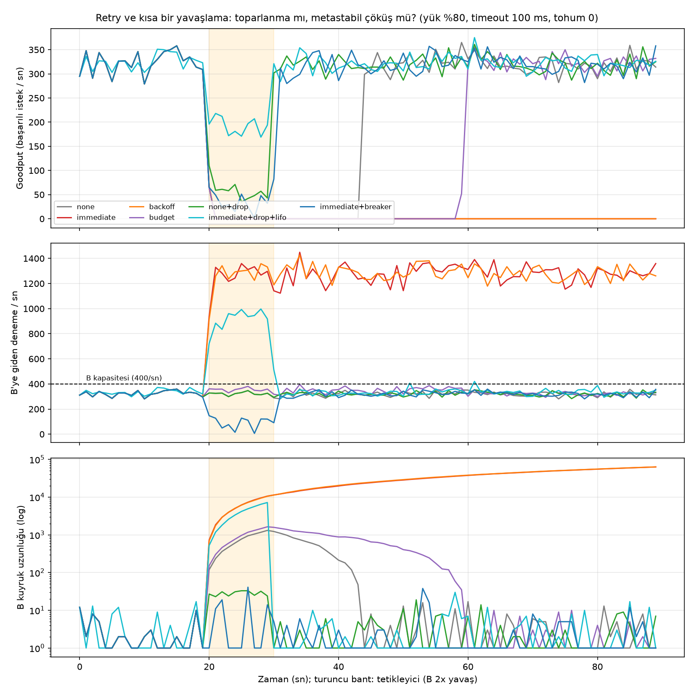

# Lab 3 — Timeouts, retries and circuit breakers: when retries cause the outage

A discrete-event simulation of a client (A) calling a service (B) with timeouts. B suffers
a short slowdown (the *trigger*); we watch, second by second, whether the system recovers
when the trigger ends or stays broken because of its own retries (a *metastable failure*,
Bronson et al., HotOS 2021).

## Model

- **Users:** Poisson arrivals at 320 requests/s (80 % of B's normal capacity).
- **B:** 4 workers sharing one FIFO queue, mean service time 10 ms (exponential) → capacity 400/s. No request cancellation: B keeps working on requests whose client has given up.
- **Trigger:** between t = 20 s and t = 30 s B's service time doubles (capacity 200/s, below the offered load). The run lasts 90 s.
- **Client:** 100 ms timeout per attempt; a late response is ignored.
- **Retry policies:**
  - `none` — no retries.
  - `immediate` — retry at once, up to 3 retries.
  - `backoff` — up to 3 retries after a capped exponential delay with full jitter (base 20 ms).
  - `budget` — retries allowed only while a token bucket has tokens; each new request adds 0.1 token, so retries ≤ ~10 % of new requests.
- **Mitigations:** `drop_expired` (B skips requests whose client deadline has passed), `lifo` (B serves the newest request first), `breaker` (circuit breaker: if > 50 % of the last 50 attempts failed, fail fast without calling B for 1 s).
- **Recovery time:** seconds after the trigger ends until goodput stays ≥ 90 % of its pre-trigger level for 3 consecutive seconds.

```bash
cd resilience
python -m pytest -q                 # mechanism tests (caps, determinism, breaker)
python benchmarks/run_sweep.py      # 8 configurations x 10 seeds
python benchmarks/plot_results.py
```

## Results



| Configuration | Success | Load amplification | Recovered | Median recovery |
|---|---|---|---|---|
| `none` | 72.1 % | 1.00 | 10/10 | 15 s |
| `immediate` | 20.4 % | 3.38 | **0/10** | – |
| `backoff` | 22.4 % | 3.32 | **0/10** | – |
| `budget` | 51.9 % | 1.05 | 10/10 | 34 s |
| `none` + `drop_expired` | 90.9 % | 1.00 | 10/10 | 0 s |
| `immediate` + `drop_expired` | 32.0 % | 3.17 | **0/10** | – |
| `immediate` + `drop_expired` + `lifo` | 95.9 % | 1.23 | 10/10 | 0 s |
| `immediate` + `breaker` | 88.4 % | 0.91 | 10/10 | 1 s |

*Success* = user requests answered within a timeout. *Load amplification* = attempts sent to B per user request. 10 seeds per configuration.

1. **A 10-second slowdown becomes a permanent outage with retries.** With `immediate` retries,
   B receives ~1 300 attempts/s (3.3× the user load, 3.3× its capacity) and keeps receiving
   them after the trigger ends. Goodput is essentially zero for the remaining 60 s and the
   queue grows without bound. None of the 10 seeds recovered. The trigger is the cause of the
   first failures; the retries are what *sustain* them.
2. **Backoff with jitter does not prevent it.** `backoff` behaves almost exactly like
   `immediate` (0/10 recovered). Jitter spreads retries in time and prevents synchronised
   spikes, but every user still makes up to 4 attempts, so the total load is unchanged.
   Backoff fixes *when* retries happen, not *how many*.
3. **Even without retries, recovery takes 15 s, because B works on abandoned requests.**
   During the trigger ~1 200 requests pile up; afterwards B serves them at its spare
   capacity of ~80/s (1 200 / 80 ≈ 15 s) although every one of those clients has already
   timed out. Goodput stays at zero until the stale backlog is gone.
4. **A retry budget avoids the collapse but slows recovery (34 s vs 15 s).** In this model
   every failure is caused by overload, so every retry is extra load on an overloaded
   server. Budgets bound the damage; they do not make retries helpful under overload.
5. **Not doing useless work is the strongest single lever.** `drop_expired` alone gives
   instant recovery and 90.9 % success.
6. **…but with retries, FIFO defeats it.** `immediate` + `drop_expired` still collapses:
   with FIFO, B always picks the oldest *still-valid* request, which is about to expire, so
   it finishes after its client has given up. Switching to **LIFO** serves the freshest
   request, which has the most time left: success 95.9 %, instant recovery. The price is
   unfairness: old requests starve even in steady state (amplification 1.23 when healthy)
   and p99 latency rises to ~304 ms because some requests succeed only on a later attempt.
7. **A circuit breaker recovers in ~1 s** by cutting load to B (amplification 0.91), at the
   cost of failing some requests during the trigger that B could have served.

## Limitations

- Discarding an expired request costs B nothing in this model; in reality it has a small cost, so `drop_expired` and `lifo` look somewhat better here than they would in practice.
- All failures are overload-induced. Random transient failures (where retries genuinely help) are not modelled.
- One client population and one server; no retries at multiple layers (which would multiply amplification further).
- The breaker is simplified: after the open period it closes with a cleared window instead of a true half-open probe phase.
- Recovery depends on the chosen 90 % / 3-second threshold.

## Why retries can make a system worse

<!-- Kendi cümlelerinle yaz (yarım sayfa - 1 sayfa). İskelet:
1. Retry'ın varsayımı: hata geçicidir ve başka bir deneme başarılı olur. Aşırı yükte bu varsayım neden yanlış?
2. Geri besleme döngüsü: tetikleyici -> timeout -> retry -> daha fazla yük -> daha fazla timeout. Bulgu 1 ve grafikteki "B'ye giden deneme" paneli.
3. Neden backoff yetmedi? (Bulgu 2: zaman ve miktar farkı)
4. Boşa giden iş: istemci vazgeçtikten sonra yapılan iş (Bulgu 3 ve 5).
5. Ne işe yarar? Bütçe, drop_expired, LIFO, breaker; her birinin bedeli.
6. Tezle bağ: tahmine dayalı autoscaler'daki thrashing de bir geri besleme döngüsü; cooldown ve güven kapısı bu döngüyü kırmak için.
-->